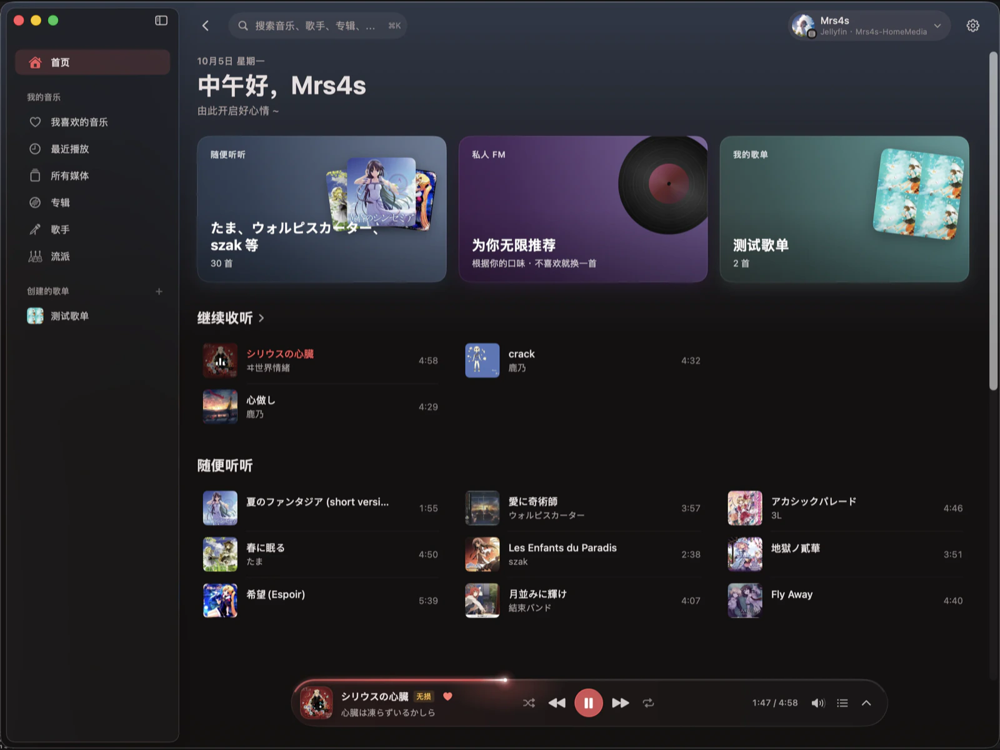
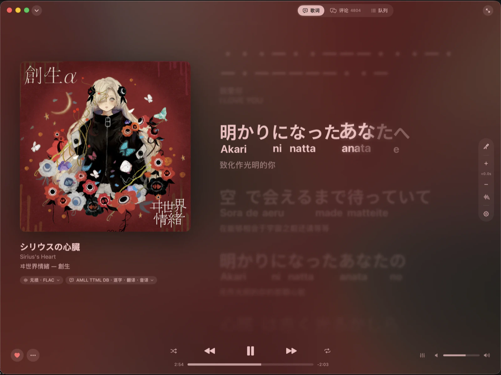
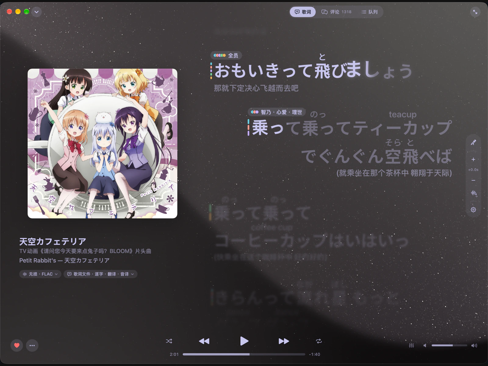
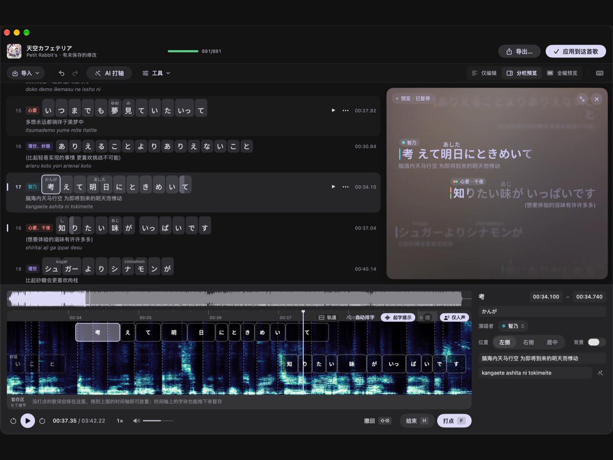

<div align="center">


# Starry Player

A high-performance native macOS music player with rich visual effects

[简体中文](README.md) · [English](README.en.md)


</div>

## Screenshots

<!-- Keep preview images at 1600 × 1200; GitHub renders them with height: auto. -->
<table>
  <tr>
    <td width="50%" align="center" valign="top">
      <a href="screenshots/screen-1.webp"></a>
      <p><strong>Home</strong><br>Browse recommendations, playlists, and recently played music</p>
    </td>
    <td width="50%" align="center" valign="top">
      <a href="screenshots/screen-2.webp"></a>
      <p><strong>Word-by-word lyrics</strong><br>Follow highlighted lyrics with translations, romanization, and animated backgrounds</p>
    </td>
  </tr>
  <tr>
    <td width="50%" align="center" valign="top">
      <a href="screenshots/screen-3.png"></a>
      <p><strong>Now Playing</strong><br>Titanium sand background and singer labels</p>
    </td>
    <td width="50%" align="center" valign="top">
      <a href="screenshots/screen-4.png"></a>
      <p><strong>High-precision lyric editor</strong><br>A wide range of tools for visual lyric timing</p>
    </td>
  </tr>
</table>

## Features

- 🎤 **Word-by-word lyrics**: Highlight each word as it is sung, with translations, pronunciation guides, and automatic lyric matching. Lyrics can also appear in the menu bar, around the notch, or on the desktop
- 🎯 **Lyric alignment**: Analyze vocals to automatically correct lyric timing with one click, and optionally use AI to generate word-by-word lyrics for songs that do not have them
- ✏️ **Lyric editor**: Drag and drop syllables on the spectrogram timeline, align their boundaries with onset cues, and preview changes in real time. See the [lyric editor guide](docs/lyrics-editor.md) (Chinese)
- 🌌 **Animated backgrounds**: Flowing cover-art backgrounds that pulse with the music, or a titanium sand background
- 🎵 **Multiple sources**: NetEase Cloud Music, Jellyfin, Subsonic / Navidrome, and local music
- 🧩 **Plugins**: A flexible plugin system lets developers add custom music sources
- 🎧 **Playback**: Gapless playback, crossfade, ReplayGain, and 10-band and parametric equalizers with support for importing AutoEQ and Equalizer APO settings
- 🎙️ **Sing-along mode**: Remove the original vocals and sing along to the accompaniment
- ⚡ **High performance**: Built natively in Swift for smooth animations and low resource usage

## Performance

Starry Player is built natively in Swift and optimized for macOS. The following measurements show the increase in total system power consumption over idle during steady playback on the lyrics page with all effects enabled:

| Player | Device | Steady-state power increase |
| --- | --- | --- |
| **Starry Player** | M4 Mac mini | **Approx. +0.8 W** |
| **Starry Player** | M5 Max (40-core GPU) | **Approx. +2–4 W** ¹ |
| NetEase Cloud Music | M5 Max (40-core GPU) | Approx. +2–3 W |
| Apple Music | M5 Max (40-core GPU) | Approx. +5 W |

¹ Components in the M5 Max system, such as its larger unified memory configuration, consume more power, resulting in a larger increase than on the M4.

## Installation

Requires macOS 14 or later.

The app is ad-hoc signed and has not been notarized, so macOS may block it the first time you open it. Right-click the app in Finder and choose **Open**, or go to **System Settings › Privacy & Security** and click **Open Anyway**.

## Development

```bash
brew install xcodegen node
scripts/bootstrap.sh       # Generate StarryPlayer.xcodeproj
open StarryPlayer.xcodeproj
```

For project structure, testing, and packaging, see the [development guide](docs/development.md) (Chinese). To write plugins, see the [plugin development tutorial](docs/plugin-development.md) (Chinese) and [SDK reference](plugins/sdk/README.md) (Chinese).

## Acknowledgments

- [AMLL TTML Lyrics Database](https://github.com/Steve-xmh/amll-ttml-db): A source of word-by-word lyrics
- [AMLL](https://github.com/Steve-xmh/applemusic-like-lyrics): The titanium sand background is ported from its Titanium background renderer
- [SPlayer-Next](https://github.com/SPlayer-Dev/SPlayer-Next): A reference for some features and implementation logic

## Disclaimer

This project is not affiliated with any music platform. Copyright in each platform's content belongs to its respective owners.

## License

This project is licensed under the [GNU Affero General Public License v3.0 (AGPL-3.0)](LICENSE).
