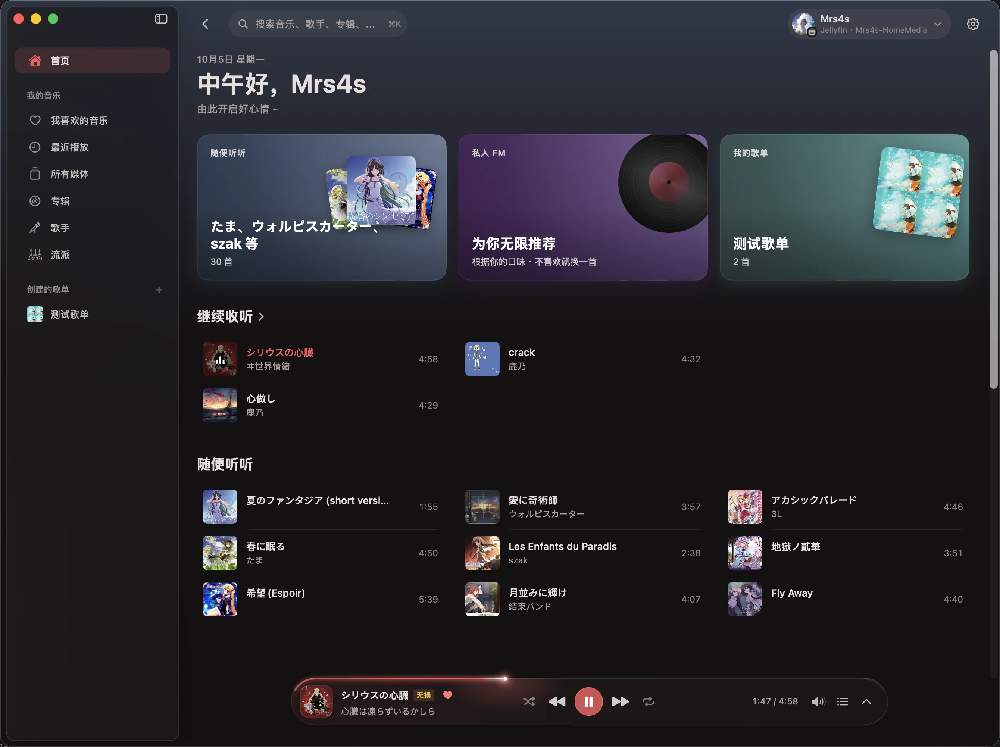
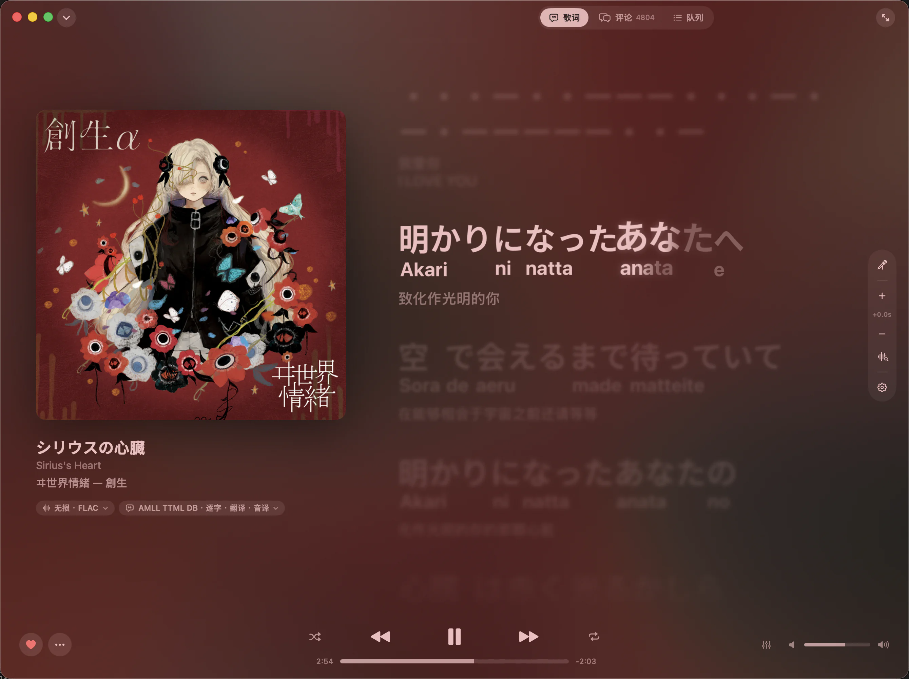
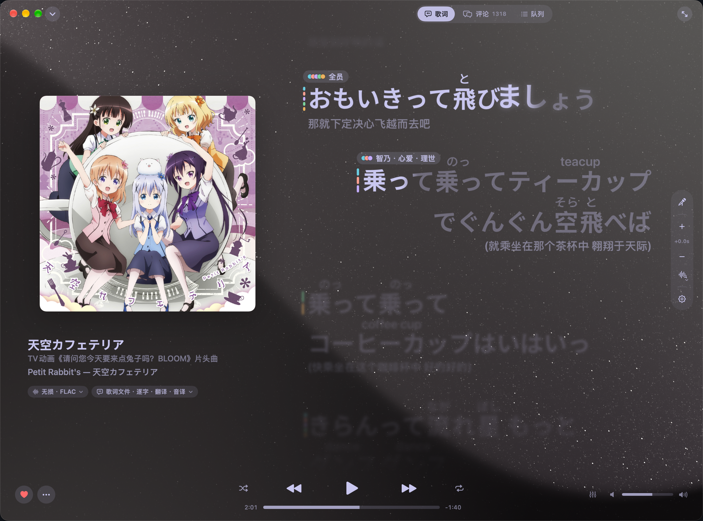
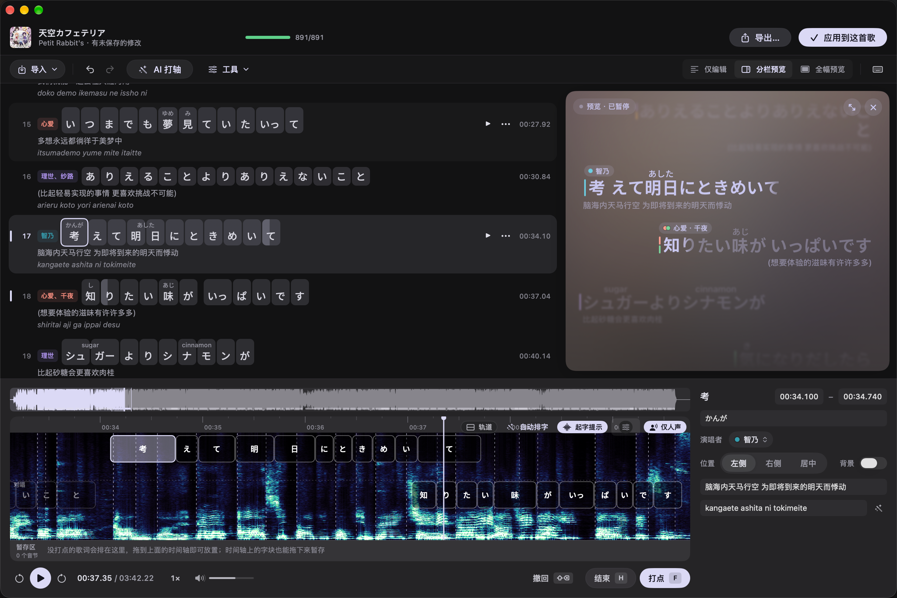

<div align="center">


# Starry Player

高性能原生全特效 macOS 音乐播放器

[简体中文](README.md) · [English](README.en.md)


</div>

## 截图

<table>
  <tr>
    <td width="50%" align="center" valign="top">
      
      <p><strong>首页</strong><br>浏览推荐、歌单与最近播放</p>
    </td>
    <td width="50%" align="center" valign="top">
      
      <p><strong>逐字歌词</strong><br>逐字高亮，搭配翻译、音译与律动背景</p>
    </td>
  </tr>
  <tr>
    <td width="50%" align="center" valign="top">
      
      <p><strong>播放页面</strong><br>钛金流沙背景和演唱者标识</p>
    </td>
    <td width="50%" align="center" valign="top">
      
      <p><strong>高精度歌词编辑器</strong><br>提供大量以视觉打轴为主的辅助功能</p>
    </td>
  </tr>
</table>

## 特性

- 🎤 **逐字歌词**：随演唱逐字点亮，带翻译和注音，歌词自动匹配，也能放到菜单栏、刘海和桌面上
- 🎯 **歌词校准**：一键分析人声自动校准偏移, 同时支持可选的为没有逐字歌词的歌曲使用AI生成逐字歌词
- ✏️ **歌词编辑器**：在频谱时间轴上拖放音节，用起字提示对齐边界并实时预览。详见[歌词编辑器使用教程](docs/lyrics-editor.md)
- 🌌 **律动背景**：流动的封面背景，跟着音乐节奏起伏；也可选钛金流沙背景
- 🎵 **多种来源**：网易云音乐、Jellyfin、Subsonic / Navidrome、本地音乐
- 🧩 **插件**：灵活的插件系统，开发者可以接入自定义音源
- 🎧 **播放**：无缝播放、交叉淡化、ReplayGain、十段与参数均衡器（可导入 AutoEQ、Equalizer APO 设置）
- 🎙️ **唱歌模式**：消去原唱人声，跟着伴奏唱
- ⚡ **高性能**：Swift 原生开发，动画流畅、占用低

## 性能

Starry Player 使用 Swift 原生开发，针对 macOS 深度优化。以下为歌词页全特效稳定播放时，相对空闲状态增加的整机功耗：

| 实现 | 设备 | 稳态功耗增量 |
| --- | --- | --- |
| **Starry Player** | M4 Mac mini | **约 +0.8 W** |
| **Starry Player** | M5 Max（40 核 GPU） | **约 +2 ~ 4 W** ¹ |
| 网易云音乐 | M5 Max（40 核 GPU） | 约 +2 ~ 3 W |
| Apple Music | M5 Max（40 核 GPU） | 约 +5 W |

¹ M5 Max 的外围部件（比如更多统一内存）功耗更高，因此增量高于 M4。

## 安装

需要 macOS 14 及以上。

安装包是 ad-hoc 签名，没有经过公证，第一次打开会被系统拦下：在 Finder 里右键 App 选“打开”，或者到 系统设置 › 隐私与安全性 里点“仍要打开”。

## 开发

```bash
brew install xcodegen node
scripts/bootstrap.sh       # 生成 StarryPlayer.xcodeproj
open StarryPlayer.xcodeproj
```

项目结构、测试和打包见 [开发文档](docs/development.md)，写插件见 [插件开发教程](docs/plugin-development.md) 和 [SDK 参考](plugins/sdk/README.md)。

## 致谢

- [AMLL TTML 歌词库](https://github.com/Steve-xmh/amll-ttml-db): 逐字歌词来源
- [AMLL](https://github.com/Steve-xmh/applemusic-like-lyrics): 钛金流沙背景移植自其 Titanium 背景渲染器
- [SPlayer-Next](https://github.com/SPlayer-Dev/SPlayer-Next): 部分功能和逻辑参考
- [KANJIDIC2 / EDRDG](https://www.edrdg.org/wiki/KANJIDIC_Project.html): 日语汉字读音数据（James William BREEN 与 EDRDG，CC BY-SA 4.0）

## 声明

本项目与音乐平台没有任何关联，各平台内容的版权归其所有者所有。

## 许可证

本项目采用 [GNU Affero General Public License v3.0（AGPL-3.0）](LICENSE) 许可证。
