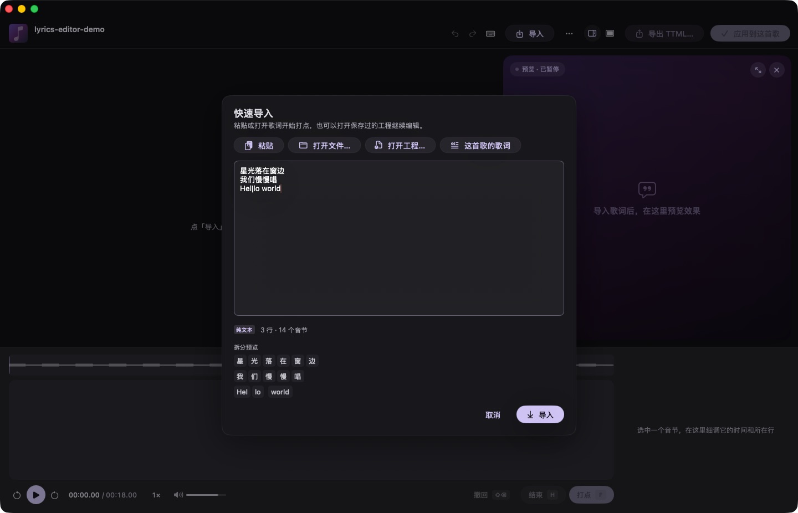
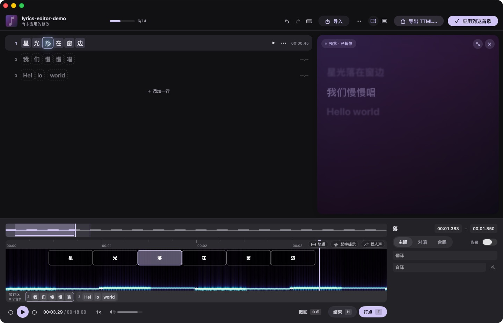
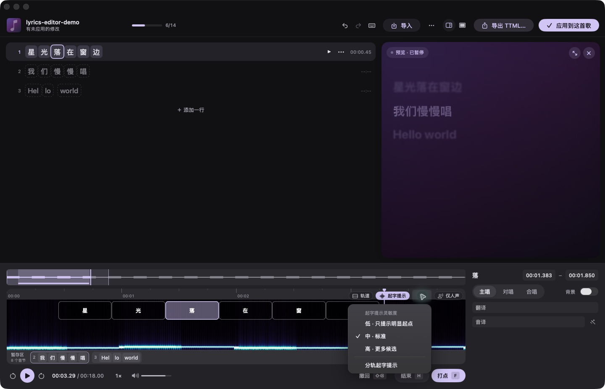
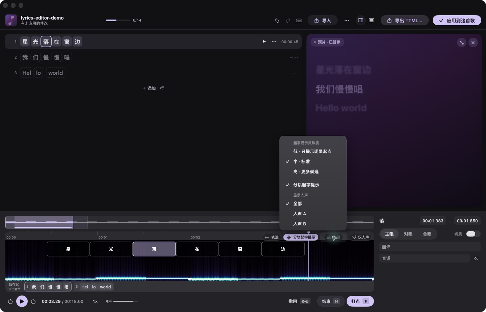
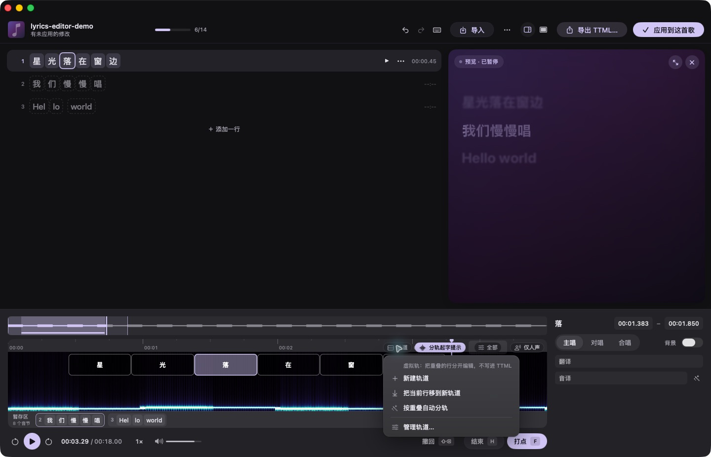
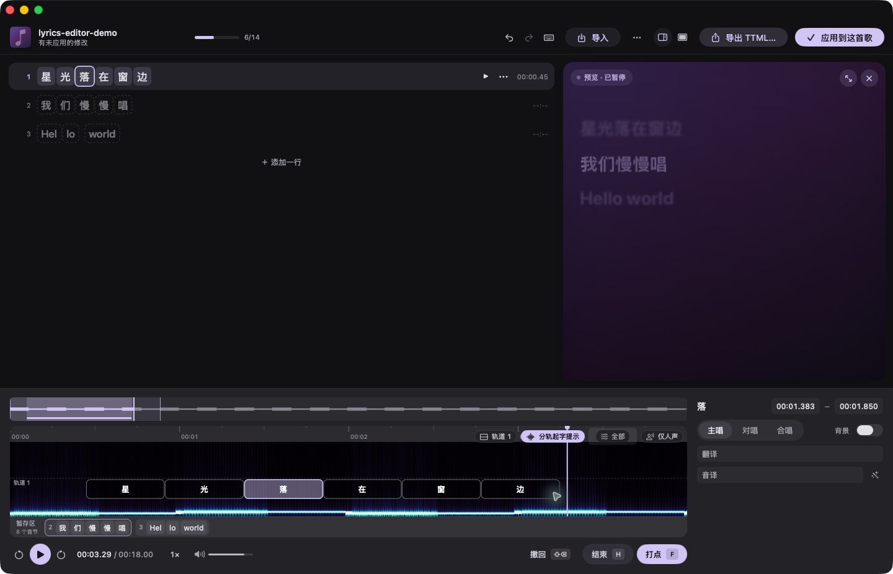
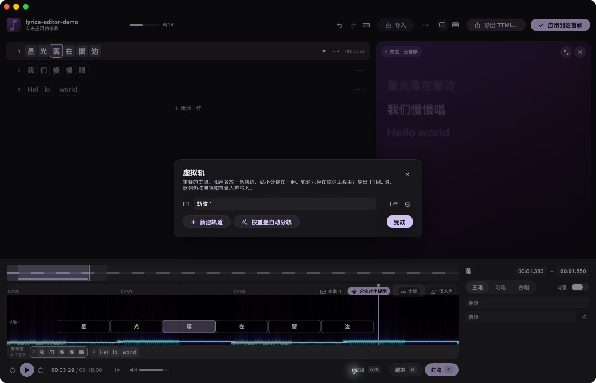
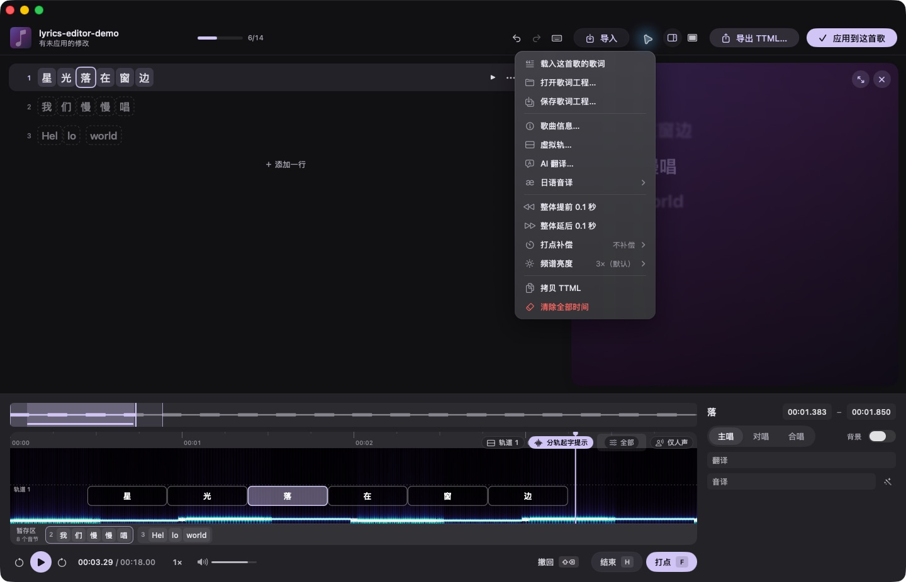

# 歌词编辑器使用教程

歌词编辑器以可拖动的时间轴为中心：借助「起字提示」找到人声起点，把歌词放到频谱上，再拖动字块边界对齐提示线、预览效果。两条人声重叠时，还可以切换「分轨起字提示」分别查看。纯文本、LRC 和已有逐字歌词都可以作为起点；完成后可应用到当前歌曲或导出 TTML。

## 打开编辑器

先在 Starry Player 中选一首歌。在播放页的歌词区域，点击「自己做歌词」；也可以打开播放页的「更多」菜单，选择「编辑歌词…」。有当前歌曲时，还可以从菜单栏的「播放」→「编辑歌词…」进入。编辑器会为这首歌打开独立窗口；再次打开同一首歌会回到已有的编辑窗口。

> 以下截图使用临时合成音频和示例歌词，仅用于展示操作界面。

## 导入并检查音节

首次打开没有歌词的歌曲时，会自动显示「快速导入」。已有内容时，点击窗口顶部的「导入」（`⌘I`）也能再次打开。

1. 直接在文本框中输入或粘贴歌词，每行一句。也可以点「打开文件…」读取歌词文件，点「这首歌的歌词」查找歌曲现有的歌词，或点「打开工程…」继续编辑之前保存的 `.starrylyrics` 工程。
2. 检查下方的「拆分预览」。中文、日文和韩文通常按字拆分，其他文字通常按词拆分。需要手动指定边界时用 `|`，例如 `Hel|lo world` 会分为 `Hel`、`lo`、`world` 三个音节。
3. 确认后点击弹窗右下角的「导入」（`⌘↩`）。**再次导入会替换当前歌词行**，但可以撤销。

支持纯文本、LRC（逐行、尖括号增强型、方括号逐字）、KRA、txt2ass 文本、SRT、ASS／SSA、Nicokara（含注音）、RL 编辑模式、Kirakara（KRL）／春日向注音，以及 TTML、YRC、QRC、KRC 逐字歌词。导入带时间的歌词时，已有时间会保留；SRT 保留每条字幕的起止时间和重叠，逐字 LRC 保留行尾结束点和句中停顿。LRC 的 `offset` 会在导入时应用一次。导入逐行 LRC 时，可用「同一时间的第二行作为翻译」开关控制同时间戳的后续行是否配对为翻译、音译。

ASS 支持卡拉 OK 时长、注音续段、SUG 演唱者切换标记及导出预显示补偿，按歌词内容与时间导入；绘图和字幕特效不会在播放器中执行。Nicokara 的 `@Ruby` 按出现时间匹配，因此同字不同读音可以分别保留。KRL 的假名与罗马音保持独立时间，文件头的 `config` 渲染配置块会跳过。旧日文 CP932／Shift-JIS、GB18030 和 Big5 文本会尝试按字符内容识别编码；导出统一使用 UTF-8。

RL 编辑文本中的多拍节奏点、尚未打点的拍和休止标记会随工程保存，休止在编辑器中显示为 `▨`，不会混入播放歌词正文。RL 格式可直接导出未完成的打轴状态。工程格式 v4 保存这些编辑信息和独立的音译时间，v5 增加共享注音；新版可以打开 v1～v4 工程，旧版应用无法打开更新格式的工程。

如果拆分不合适，双击歌词行或打开该行的「更多操作」→「编辑文本」，用 `|` 调整音节边界，按回车保存，按 `Esc` 取消。音节的右键菜单也提供「拆成单字」和「与后一个合并」。

## 认识编辑界面

导入后，左侧按行显示歌词和音节；右侧是播放效果预览。底部上方的细长波形是整首歌概览，下方大区域是当前时间段的时间轴。时间轴最底部的「暂存区」列出还没有时间的歌词，已放置的音节则显示为频谱上的字块。右下角可修改当前音节的时间和所在行的信息。

点击左侧某个音节可切换到它所在的行。要找歌曲中的另一处，点按或拖动整曲概览；拖动概览里的方框可移动下方时间轴，拖动方框两侧可调整显示范围。在时间轴上滚轮可平移，`⌘` 加滚轮或捏合可缩放。底部面板的上边缘还能上下拖动，给时间轴更多空间。

## 用拖放安排歌词时间

1. 从暂存区的行号或字块之间拖动**一整行**到时间轴上的大致位置。想单独放一个音节，就从暂存区拖动那个字块。放下后，歌词会以字块出现在时间轴上；也可以双击暂存区的行或音节，将其放到播放头位置。
2. 拖动字块中间可移动整个音节，拖动左右两端可调整开始和结束时间。按住 `⌘` 拖动字块可移动整行；把整行上下拖到其他虚拟轨，还可以换轨。
3. 边看波形或频谱边对齐每个字块。拖动边界时可以吸附到附近的时间点；「起字提示」还能提供疑似人声起点，具体操作见下节。
4. 放错位置时，把字块拖回暂存区，`⌘` 拖动可将整行移回；再次放到时间轴时会保留原来的长度。也可以用 `⌘Z` 撤销、`⇧⌘Z` 重做。

初次从暂存区放置纯文本时，字块会先获得便于编辑的时长，再通过拖动边界确定实际长度。导入 LRC 后，整行放置会利用原有的行时间。顶部的进度数字显示「已有时间的音节数 / 总音节数」。

## 用起字提示对齐字块

「起字提示」会分析分离出的人声，在频谱上以竖向虚线标出疑似开口的时间。它提供拖动时的对齐参考，**不会自动改动歌词时间**。可以按下面的顺序使用：

1. 在时间轴右上角点击「起字提示」，等待「准备人声…」「分析起字点…」结束。提示可用时，时间轴上会出现竖向虚线。若界面只有波形、没有频谱，当前音频可能无法预先解码，起字提示控件不会显示。
2. 点击「起字提示」旁边的设置按钮，选择灵敏度：「低」只保留明显起点，「中」为标准，「高」显示更多候选。提示太密时调低；遗漏明显起点时调高。
3. 从暂存区拖出一行或一个音节，靠近虚线放下，放置位置会吸附到附近的提示点。已有字块需要校准时，**拖动左边缘**对齐起字点，拖动右边缘调整结束时间。按住 `⌘` 拖动整行时，会以该行第一个有时间的音节对齐附近的起字提示。
4. 从暂存区放置时，观察时间轴上的对齐线和时间标签；调整已有字块时，可看右下角的起止时间。吸附只在提示点附近生效；按住 `⌥` 拖动可暂时跳过起字提示吸附，手动放到想要的时间。松开后用右侧预览复核。单独拖动字块中间用于平移该音节，校准起字点请拖左边缘。

提示来自自动分析，尤其在伴奏强、咬字轻或连续唱词时可能缺失或多出。可点「仅人声」查看分离后的人声频谱，再结合预览决定最终边界。

### 两条人声重叠时：分轨起字提示

在「起字提示」旁的设置菜单中勾选「分轨起字提示」，等待本地分离两条人声并分析完成。随后在同一菜单的「显示人声」中选择「全部」「人声 A」或「人声 B」：先用「全部」找重叠段，再切换 A、B，观察哪组虚线对应当前要编辑的演唱，按上面的拖拽方法对齐字块。启用「仅人声」后，频谱也会跟随 A/B 选择，便于查看各自的起字位置。

A/B 是自动分离的编号，不一定固定对应主唱或对唱；重叠处若归属不清，请结合预览和试听确认。若分析失败，可从设置菜单重试。「分轨起字提示」只切换分析提示与人声频谱；要把重叠的歌词行分开放置，请使用下面的虚拟轨。

## 用虚拟轨整理重叠歌词

虚拟轨是时间轴上的编辑位置。两行歌词在同一时段重叠时，把其中一行放进虚拟轨，就能分别看到和拖动两行的字块。它与上面的 A/B 人声提示是两套功能：提示帮助找起字时间，虚拟轨负责摆放歌词行。

1. 在左侧选中要分开的歌词行，点击时间轴右上角的「轨道」→「把当前行移到新轨道」。菜单上的「新建轨道」只创建空轨道，不会移动当前行。
2. 已有轨道时，按住 `⌘` 拖动时间轴上的任一字块，可把**整行**上下拖到目标轨道；尚在暂存区的整行也可直接拖到目标轨道。还可以打开该行的「更多操作」→「虚拟轨」，选择已有轨道或「新建轨道并移过去」。
3. 多行已经有时间且互相重叠时，点「按重叠自动分轨」：编辑器会把与前面歌词重叠的行移到空闲轨道；没有空闲轨道时新建一条。完成后检查每行的位置，必要时再手动移动。
4. 要让当前行回到按演唱分配的位置，选中该行后点「轨道」→「把当前行移回按演唱分的轨道」，或在该行的「虚拟轨」子菜单中选择「不放在轨道上（按演唱）」。

菜单里的「管理轨道…」会打开管理面板，可修改轨道名称、查看各轨道的歌词行数，或继续新建与自动分轨。点某条轨道右侧的减号会删除该轨道；其上的歌词行会回到按「主唱／对唱／合唱」及「背景」分配的位置，歌词和时间不会因此删除。

虚拟轨只保存在 `.starrylyrics` 歌词工程中。导出 TTML 或应用到歌曲时，不会写入虚拟轨布局；歌词仍按每行的「演唱」与「背景」设置输出。要保留轨道供下次继续编辑，请使用「保存歌词工程…」。

## 设置演唱角色

对唱、合唱或多人演唱的歌曲，可以为每位演唱者建立「演唱角色」，再把歌词行交给对应的角色。角色写入 TTML 的 `ttm:agent`，Starry Player 和其他支持 AMLL TTML 的播放器都能据此区分演唱者。

1. 打开窗口顶部「工具」→「演唱角色…」；也可以在歌词行的「更多操作」→「演唱」中选择「设置演唱角色…」。
2. 点「添加」新建歌手、组合或剧中角色，在下方填写名称和别名；剧中角色还可以指定「饰演者」。歌词已经设置过主唱、对唱、合唱时，可以直接点「按现有演唱生成」。
3. 在左侧选中一个角色，再点按右侧的歌词行：点按把这一行交给该角色，再点一次取消；`⌘` 点按把它加为同唱者；`⇧` 点按把两次点按之间的行一起分配。「批量」菜单可以把未分配的行一次交给当前角色，或清除全部分配。
4. 右侧列表按播放页的布局预览：排在最前的歌手在左，其他歌手在右，组合或多人同唱居中。上移、下移角色或修改类型时，相关的行会跟着移动。点行尾的播放按钮可从这一行试听，正在播放的行左侧会亮起标记。

一行中只有几个字由别人演唱时，在左侧选中这些音节后右键，选择「单独演唱」并指定角色；选择「跟随所在行」即可还原。这些音节在左侧会显示一条角色颜色的下划线。一行的所有音节都指定给同一个角色时，编辑器会直接把整行交给它。

建立角色后，右下角的「主唱／对唱／合唱」切换会换成角色选择器。角色的所有修改都可以用 `⌘Z` 撤销、`⇧⌘Z` 重做，在角色面板中同样有效。删除角色时，由它单独演唱的部分改为未分配，同唱的其他角色保留。角色会保存在 `.starrylyrics` 歌词工程中，应用到歌曲或导出 TTML 时一并写入；含演唱角色的工程无法用旧版本打开。

### 角色颜色与组合成员

新建的角色会自动取一个还没被占用的颜色。在角色面板中选中角色，可以在「颜色」一行换成其他预设色，或点取色器自定义；选「自动」则交给调色板分配。组合还有「成员」一行，勾选组成这个组合的歌手；组合演唱的行在播放页按成员的颜色显示。

歌词里有多位演唱者、并且至少一个角色设置了颜色时，播放页会在每位歌手开口的位置前显示一条该歌手颜色的色条：一行由两人分唱时，换人处会空出一点距离放第二条色条；多人同唱时，色条按人数分成上下几段。正在唱的行上方还会标出每段的歌手名，还没唱到的较淡。设置 › 播放页中的「演唱者标记」「显示演唱者名字」可以关闭它们；所有角色都设为「自动」颜色时，播放页不显示这些标记。

颜色和成员导出为 TTML 扩展属性 `ttv:color`、`ttv:members`（命名空间 `urn:ttml:extensions:vocalist-style:1`），只写在 `<head>` 的 `ttm:agent` 声明上，歌词正文与不带扩展时完全相同。AMLL 等其他播放器会忽略这些属性，照常按 `ttm:agent` 区分演唱者。导出为其他格式时，颜色和成员会作为角色信息列在保存窗口的丢失项中。含角色颜色的工程无法用旧版本打开。

## 精调并预览

点击左侧或时间轴上的音节，右下角会显示它的「开始」「结束」时间，可以直接输入精确数值。选中音节后，`⌥←` / `⌥→` 每次微调 10 毫秒，加上 `⇧` 则每次微调 100 毫秒。整首歌词整体偏移时，可从顶部「更多」选择「整体提前 0.1 秒」或「整体延后 0.1 秒」。

选中一行后，按 `L` 可用默认参数自动排字，分析完成后直接应用，无需打开设置面板。已有逐字时间时默认校准，否则重新排字；语言自动识别，人声使用「全部」，校准搜索距离为 ±0.35 秒。没有行时间时，默认从播放头位置开始。应用后可用 `⌘Z` 撤销；需要调整范围或参数时，点击时间轴上的「自动排字」按钮。输入文字时不会触发此快捷键。

右侧预览会显示当前播放位置的歌词效果。按空格播放或暂停，点按时间轴空白处可跳转；窗口顶部按钮可隐藏预览或切换全幅预览。选中某行后，还可以在右下角填写「翻译」「音译」，设置「主唱」「对唱」「合唱」以及「背景」；建立演唱角色后，这里改为选择演唱角色。

## 添加注音

日语汉字上的假名、汉字上的拼音这类注音（TTML 中的 ruby）按音节添加。导入已带注音的 AMLL TTML 时，注音及其时间都会保留。

1. 选中一个音节，在右下角的「注音」框输入读音，按回车保存；清空后保存即去掉注音。也可以打开音节的右键菜单，选择「编辑注音…」或「清除注音」；多选音节后右键，可一次清除它们的注音。
2. 用 `|` 可把一个音节的注音分成几段，例如「詮」填 `せ|ん`，播放时注音会一段段亮起；不分段则整段随音节一起亮起。
3. 注音的时间跟着所在音节：拖动字块或打点改变音节时间时，注音按比例一起移动；只有段数改变时，才按字数重新平分。
4. 读音无法拆到单个音节时，例如熟字训「今日」きょう、汉字唱作英语的「運命」destiny，或按音节拆开的英文词注片假名，可以让相邻的几个音节共享一个注音，各音节保留自己的时间：按住 `⌘` 或 `⇧` 选中同一行里相邻的音节，在「注音」框填写读音，或在右键菜单中选择「共享注音…」。注音末尾带空格的段会保留空格，可以分开英文单词，例如 `eternal |love`。共享注音显示在这几个音节的正上方；选中其中任意一个音节即可修改或清空整段注音。AI 打轴会按共享注音的读音对齐这几个音节；注音按 `|` 分成与音节数相同的段时，每段对应一个音节；否则按英文单词的音节或汉字的读音推断各音节的分界，推断不出时按读音平均分配，并标为待核对。
5. 合并带注音的音节时注音会一起合并；「拆成单字」会去掉音节自己的注音，共享注音则保留在拆出的各音节上。共享注音的音节只能与同组的音节合并；删除、移走或改写其中一部分音节，会去掉这段共享注音。

也可以让 AI 一次生成整首歌的注音：在顶部「更多」中选择「AI 翻译与注音…」，勾选「注音」并填写注音用字（默认平假名），复制 Prompt 交给 AI，再把它的回复粘贴回来。注音只加在含汉字的音节上，熟字训、当て字这类读音会作为共享注音写在整个词上；关闭「覆盖已有内容」时，已有注音的音节（包括共享注音中的音节）保持不变。

左侧歌词行在音节上方显示注音，右侧预览则与播放页一样把注音显示在字的上方；设置中的「显示注音」可以关闭它。导出 TTML 时，注音按 AMLL 的 `tts:ruby` 格式写出；共享注音写成扩展属性，AMLL 等其他播放器会忽略它，只显示不带注音的原文。导出其他格式时，不能保留共享注音的格式会在导出窗口中标为「部分保留」。歌词工程也会保存注音；含注音功能的版本保存的 `.starrylyrics` 工程，旧版本无法打开。

## AI 搜索歌曲信息

打开顶部「更多」→「歌曲信息…」，点击「AI 搜索…」。勾选需要搜索的歌名、歌手、专辑、ISRC 或各平台歌曲 ID，也可以补充版本、地区等线索。点击「复制 Prompt」，将它粘贴到支持联网搜索的 AI Chat，并开启搜索功能。

Prompt 会带上当前歌曲信息、时长和前 8 行非空歌词，要求 AI 核对同一录音版本、提供来源链接，无法确认的项目留空。把 AI 返回的完整 JSON（可以带代码块）粘贴回来，核对预览中的现有信息、搜索结果和来源，再点击「应用」回填。默认只补全空白项目；需要纠正已有信息时开启「覆盖已有内容」。未找到的项目会保留原值，多位歌手分别保存，应用可用 `⌘Z` 撤销。

关闭面板后，勾选项目和已粘贴的回复会保留在当前编辑会话中。回填的信息会随歌词工程保存，并在应用歌词或导出 TTML 时写入。

## 顶部「更多」菜单

窗口顶部「导入」旁的「更多」菜单集中放置文件操作和编辑设置：

| 菜单项 | 作用 |
| --- | --- |
| 「载入这首歌的歌词」 | 查找这首歌已有的歌词并载入编辑器，会替换当前歌词。 |
| 「打开歌词工程…」「保存歌词工程…」 | 继续编辑或保存包含虚拟轨的 `.starrylyrics` 工程。 |
| 「歌曲信息…」「虚拟轨…」「演唱角色…」 | 分别打开歌词信息、虚拟轨和演唱角色管理面板。 |
| 「AI 翻译与注音…」「日语音译」 | 前者生成 Prompt 交给你使用的 AI，可选翻译、音译和注音，再把 AI 的回复粘贴回来应用；后者在本机生成、补全日语罗马音。生成后仍可手动校对。 |
| 「整体提前 0.1 秒」「整体延后 0.1 秒」 | 将整首歌词的时间一起移动，适合整体不同步时使用。 |
| 「打点补偿」 | 调整以后用打点键或按钮记录时间时的提前量；拖动时间轴字块不受它影响。 |
| 「频谱亮度」 | 调整时间轴频谱的显示亮度，不改变歌词时间。 |
| 「拷贝 TTML」「清除全部时间」 | 前者将当前歌词复制为 TTML；后者清除音节的起止时间、保留歌词文本，可用 `⌘Z` 撤销。 |

时间轴右上角还有各自的设置入口：「轨道」用于编辑布局，「起字提示」旁的按钮用于灵敏度和 A/B 人声选择。频谱显示方面也可切换「仅人声」。这些入口的位置可对照上面的截图。

### 可选：听音打点

如果习惯边听边记时间，也可以从左侧选中音节，播放时按 `F` 记下当前音节的开始时间并移到下一个；遇到停顿或行尾，按 `H` 结束刚唱的音节。`⇧⌫` 可撤回上一次打点。底部有对应按钮；窗口顶部的键盘按钮或 `?` 可查看其他快捷键。

## 保存与使用

| 操作 | 用途 |
| --- | --- |
| 「应用到这首歌」（`⌘S`） | 让 Starry Player 在播放这首歌时使用当前编辑的歌词。 |
| 「导出…」（`⌘E`） | 选择格式，查看内容保留情况和文件预览，再导出或拷贝文本。支持 TTML、LRC、卡拉 OK、字幕、纯文本和歌词工程。`↑` / `↓` 切换格式，`↩` 导出，`⌘C` 拷贝文本。 |
| 「导出…」→「歌词工程」，或 `⇧⌘S` | 保存 `.starrylyrics` 工程，保留未打点的音节和虚拟轨，便于之后继续编辑。用「打开工程…」（`⌘O`）恢复。 |

如果仍有音节没有打点，应用前会确认；导出窗口则在所选格式需要这些时间时直接提示：这些音节将按前后已打点的时间平均分配。逐行格式只需行时间，纯文本不需要时间，RL 编辑模式保留未完成状态。应用和带时间的导出还会检查时间重叠等问题；导出窗口会说明问题所在，点「去修改」即可跳到对应音节。导出其他格式不会将工程标记为已保存。包含额外节奏点或休止编辑状态时，应用到歌曲或导出 TTML 后也需要另存 `.starrylyrics`，才能完整恢复工程。

窗口顶部的键盘按钮或 `?` 可以查看全部快捷键。常用的还有 `⌘Z` 撤销、`⇧⌘Z` 重做，以及 `⇧←` / `⇧→` 后退或前进 3 秒。
